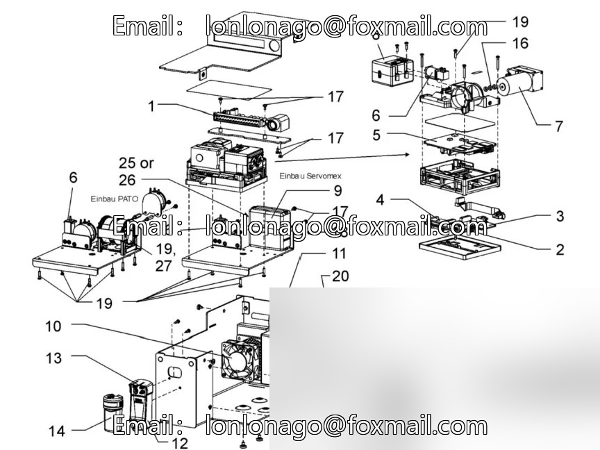
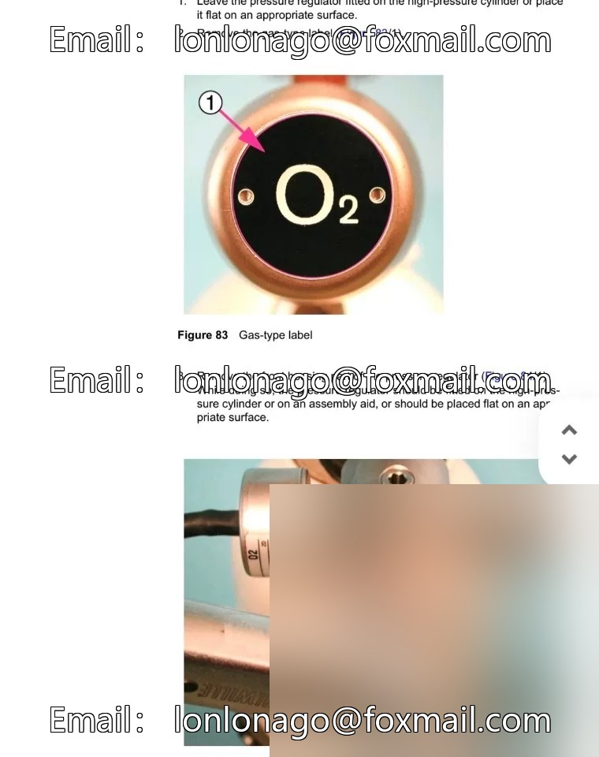
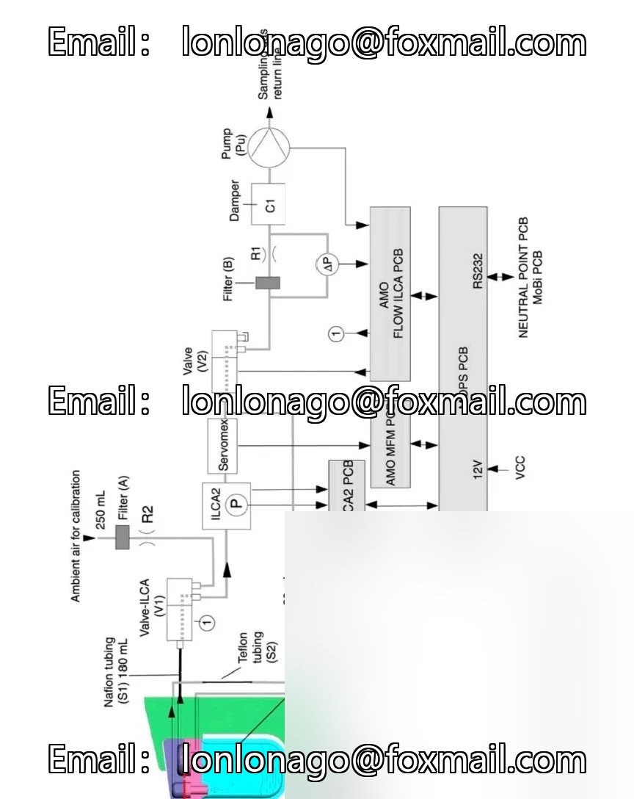
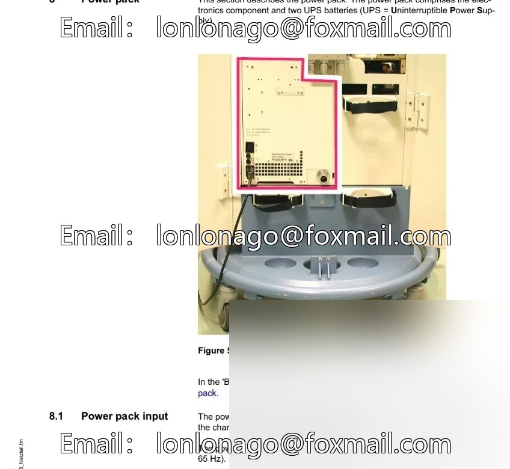
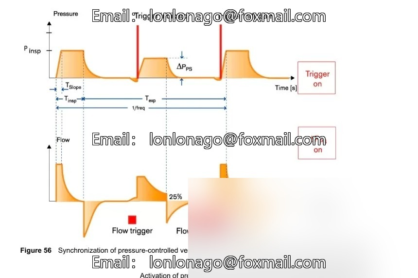
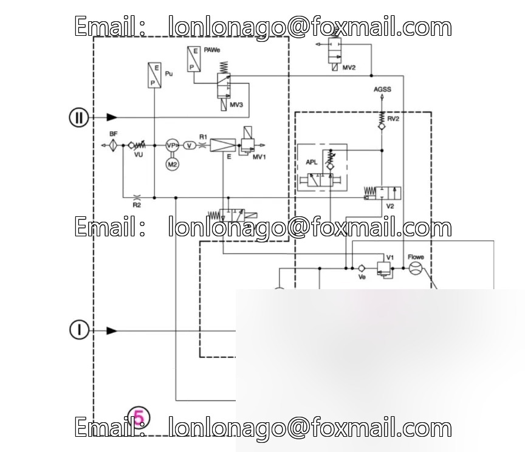
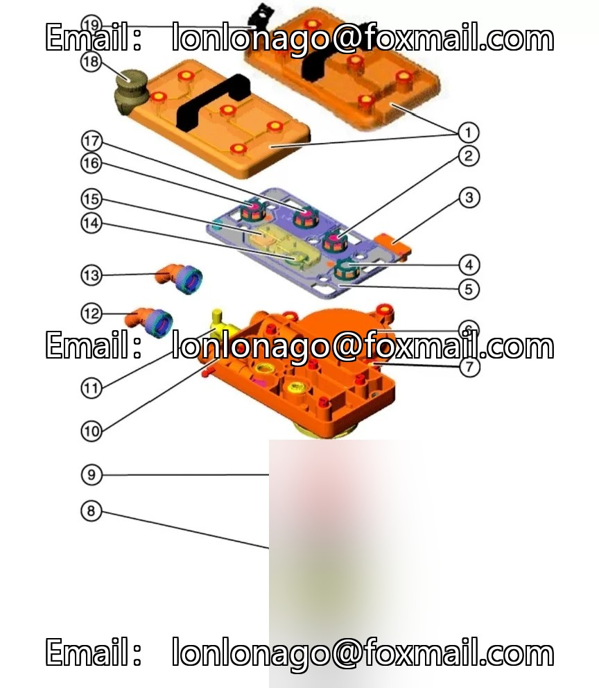

# Dräger medical (Dräger, affiliated with Dräger)

## Body

Dräger medical (subsidiary of Dräger and Siemens) Primus anesthesia workstation technical document PDF version, 330 pages, content covers workstation structure, principles, operation, maintenance, etc., suitable for repair, learning and reference.
356923723-303

The document covers Dräger medical and its affiliated entities' Primus anesthesia workstation technology, including structure, principles, operations and maintenance, with a 330-page PDF.

<!-- AI_ENRICHED -->

## Images

## Payment

Here is a pay link on Stripe ( https://buy.stripe.com/3cs8yP7sY87d0vu9AB ). Please contact me lonlonago@foxmail.com after funding $89, and I will send you a complete data files , thank you!

